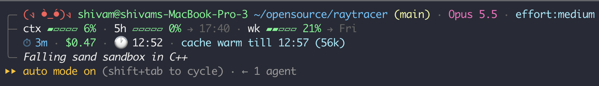

# moodline

A status line for [Claude Code](https://claude.com/claude-code) with a small kaomoji avatar whose mood follows your repo, the time of day, and whether Claude is working.

```
╭─ (ง •̀_•́)ง you@mac ~/code/app (main) · Opus 5.5 · effort:medium · ⚡fast
├─ ctx ▰▰▰▱▱ 42% · 5h ▰▰▰▰▱ 63% → 16:30 · wk ▰▰▰▰▰ 85% → Wed
│  ⏱ 1h32m · $3.46 · 🕐 14:30 · cache warm till 15:10 (84k)
╰─ refactor auth flow
```



## Moods

| Avatar | When |
| --- | --- |
| `(ง •̀_•́)ง` | Claude is working on your prompt |
| `(・‿・)ﾉ` | Claude finished and is waiting for you |
| `(－_－) zZ` | It's between midnight and 6am |
| `(・ω・)` | Not in a git repo |
| `(•̀ᴗ•́)و` | Repo has uncommitted changes |
| `(◕‿◕)` | Repo is clean |

Working and waiting come from hooks, so they win over the others.

## What each line shows

1. **Who and where:** avatar, `user@host`, directory, git branch, model, effort level, fast mode.
2. **Limits:** context window use, 5-hour and weekly plan usage with reset times. Bars turn yellow at 50% and red at 80%.
3. **Spend:** session duration, cost, clock, and prompt cache state. When the cache is cold and would re-send more than 150k tokens, or the context is over 200k, it suggests `/compact`.
4. **Session name**, if the session has one.

Lines and fields that Claude Code doesn't send are left out.

## Install

Requires `bash`, `jq` and `git`. Works on macOS and Linux.

```sh
git clone https://github.com/shivamsingh262/moodline.git
cd moodline
./install.sh
```

The installer copies the scripts to `~/.claude/moodline/` and adds the `statusLine` and four hooks (`UserPromptSubmit`, `Stop`, `StopFailure`, `SessionEnd`) to `~/.claude/settings.json`. Your other settings and hooks are kept, and a timestamped backup of `settings.json` is written first. Run it again to update.

To remove it:

```sh
./install.sh --uninstall
```

`CLAUDE_CONFIG_DIR` is respected if you've set it.

## Configure

Set these as environment variables, either in your shell profile or inline in the `statusLine.command`, e.g. `"MOODLINE_HIDE_HOST=1 ~/.claude/moodline/statusline.sh"`.

| Variable | Default | Effect |
| --- | --- | --- |
| `MOODLINE_HIDE_HOST` | unset | `1` hides `user@host`, handy for screenshots and streams |
| `MOODLINE_LINES` | `head,limits,spend,name` | Which lines to show, in that order |
| `MOODLINE_WARN` | `50` | Percentage at which bars turn yellow |
| `MOODLINE_CRIT` | `80` | Percentage at which bars turn red |
| `MOODLINE_FACE_WORKING` / `_WAITING` / `_NIGHT` / `_NOREPO` / `_DIRTY` / `_CLEAN` | see table above | Your own avatars |

## How it works

Claude Code pipes session JSON to `statusline.sh` on every refresh. The script reads it in a single `jq` call, checks git, and prints the frame. `moodline-hook.sh` writes `working` or `waiting` to `~/.claude/moodline-state/<session id>` when you submit a prompt or Claude stops, and deletes the file when the session ends.

## Development

```sh
test/run.sh            # golden-file tests + install/uninstall round trip
test/run.sh --update   # regenerate test/expected/ after an intended change
```

Tests pin the clock and timezone, use a throwaway `HOME` and git repos, and compare output with colors stripped. CI runs them on Ubuntu and macOS, plus `shellcheck`.

## License

MIT
